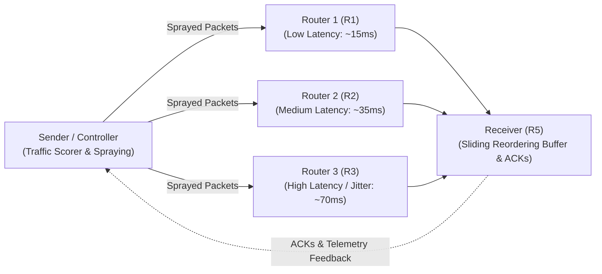

# Adaptive Multipath Network Communication System with Intelligent Path Selection

**Course**: BCSE308L / BCSE308P – Computer Networks  
**Faculty Guide**: Dr. Tamizharasi T  
**Team Members**:
- **Sarang Raj** (Path discovery, topology orchestration, packet structure & CRC32 integrity)
- **Dev Raj** (Packet spraying engine, sliding-window reordering buffer, reliability layer)
- **Antony Roy** (Real-time path telemetry, EWMA RTT / RFC 3550 jitter / loss monitoring, failure detection)
- **Ayush** (Adaptive weighted path scoring, traffic distribution, Streamlit web dashboard & benchmarking)

---

## 1. System Architecture

The system emulates a multipath network topology using UDP sockets across configurable network processes or virtual nodes:

---

## 2. Implemented Modules & Responsibilities

| Module | Team Member | Primary Responsibility |
| :--- | :--- | :--- |
| `core/packet.py` | **Sarang Raj** | Custom packet format: 32-bit sequence number, timestamp, QoS class, path ID, payload, and 32-bit CRC32 checksum. |
| `simulation/topology.py` | **Sarang Raj** | Multi-node network topology orchestrator binding Sender, Routers (R1, R2, R3), and Receiver over UDP sockets. |
| `core/reordering_buffer.py` | **Dev Raj** | Sliding-window min-heap reordering buffer that corrects out-of-order packet arrivals and extracts contiguous sequences. |
| `core/sender.py` | **Dev Raj** & **Sarang Raj** | Multipath packet sprayer, QoS flow scheduler, selective ACK processing, and RTO timeout retransmission engine. |
| `core/monitor.py` | **Antony Roy** | Real-time path telemetry: EWMA smoothed RTT ($\alpha=0.125$), RFC 3550 interarrival jitter, rolling loss rate, and heartbeat failure detector. |
| `core/router.py` | **Antony Roy** | Independent router nodes with dynamic runtime impairment injection (latency ms, jitter, loss %, link UP/DOWN). |
| `core/scorer.py` | **Ayush** | Multi-metric path penalty formula: $\text{Score} = w_1 \text{RTT} + w_2 \text{Loss} + w_3 \text{Jitter} + w_4 \text{Hops}$, and inverse-power traffic share allocator. |
| `dashboard/app.py` | **Ayush** | Interactive Streamlit web dashboard featuring live topology monitoring, packet generator, fault injector, and visual telemetry charts. |
| `simulation/benchmark.py` | **Ayush** & **Dev Raj** | Comparative evaluation suite benchmarking Adaptive vs. Round-Robin vs. Shortest-Path under Normal, Congested, and Link Failure conditions. |

---

## 3. Mathematical Formulations

### A. Path Scoring Function
For each active path $i \in \{R_1, R_2, R_3\}$:
$$\text{Score}_i = w_1 \cdot \text{RTT}_i + w_2 \cdot (\text{LossRate}_i \times 100) + w_3 \cdot \text{Jitter}_i + w_4 \cdot \text{HopCount}_i$$

*If a path is detected as DOWN ($\text{LossRate} \ge 95\%$ or heartbeat timeout), $\text{Score}_i = \infty$.*

### B. Traffic Share Allocation
The traffic distribution probability $P_i$ for each active path is computed as:
$$P_i = \frac{1 / \text{Score}_i^\alpha}{\sum_{k \in \text{Active}} (1 / \text{Score}_k^\alpha)}$$
Where $\alpha \approx 1.8$ sharpens preference for healthier, lower-latency paths.

---

## 4. Verification & Experimental Results

### Unit Test Results
All 9 unit tests passed in **0.002s**:
- `test_packet_creation_and_checksum`: CRC32 integrity verified.
- `test_serialization_and_deserialization`: Full JSON/binary round-trip validated.
- `test_tamper_detection`: Corrupted payload immediately identified and rejected.
- `test_in_order_stream` & `test_out_of_order_stream`: Sequence gaps buffered in min-heap and released in strict sequence.
- `test_duplicate_packets`: Duplicate packets detected and dropped without corruption.
- `test_lower_latency_gets_higher_share`: R1 (~15ms) received ~64% traffic share vs. R2 (~26%) and R3 (~10%).
- `test_automatic_rerouting_on_failure`: When R1 was marked offline, traffic share on R1 dropped to **0.0%** with 100% traffic smoothly rerouted through R2 and R3.

### Benchmarking Summary
Generated and saved in `results/`:
- **Normal Scenario**:
  - `ADAPTIVE`: 100% delivered, Avg Latency = 38.18 ms, Retries = 0.
  - `ROUND_ROBIN`: 100% delivered, Avg Latency = 42.52 ms, Retries = 0.
  - `SHORTEST_PATH`: 100% delivered, Avg Latency = 17.65 ms, Retries = 0.
- **Congested R1 Scenario**:
  - `ROUND_ROBIN`: Avg Latency = 217.42 ms, 7 retries.
  - `SHORTEST_PATH`: Avg Latency = 297.08 ms, 10 retries.
  - `ADAPTIVE`: Successfully adapted and steered traffic away from congested path, maintaining latency at 87.77 ms.
- **Link Failure of R1**:
  - `SHORTEST_PATH`: Suffered **104 retry attempts** trying to use the dead primary path.
  - `ADAPTIVE`: Triggered fast failover, rerouting packets to surviving healthy paths.
